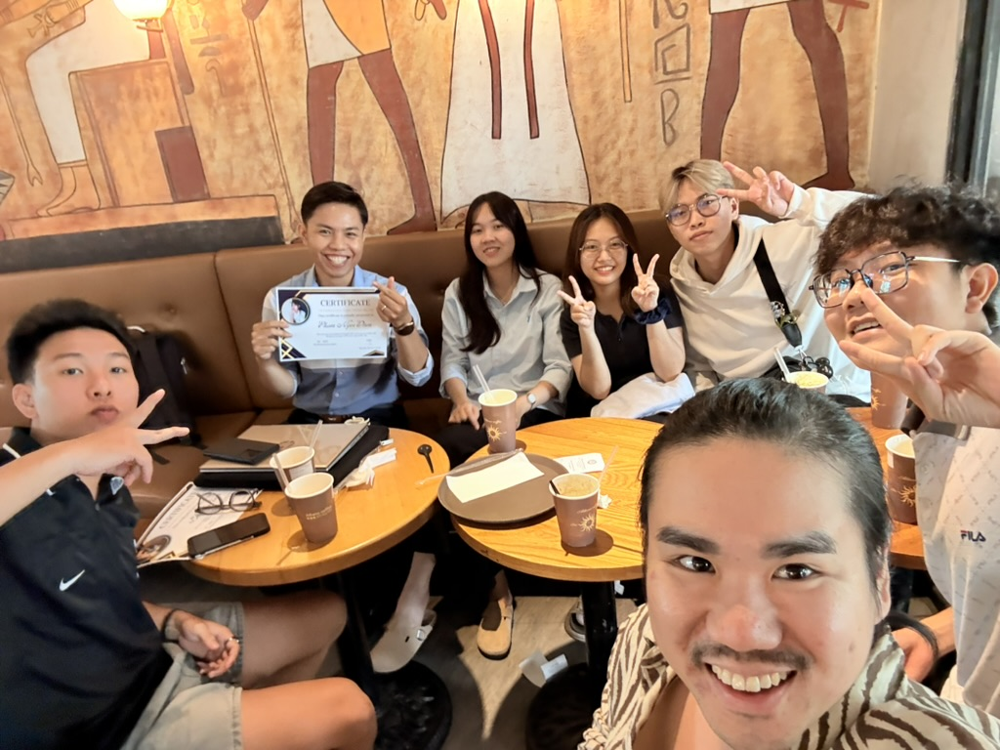

Founder Bottleneck Diagnostician

# You hired senior leaders to own the decisions. They still come back to you.

I'm Trung Nguyen. I work with founder-led companies at exactly this point. I find out why the decisions route back to you, whether it's the person, the role or a setup nobody changed when they arrived. Then we move them to the people you hired to own them.

[How the diagnostic works](/founder-diagnostic)

[Who is Trung Nguyen? →](/about)

Before this: one of two people on Contentful's security team, then infrastructure lead at Workpath.

## This is for you if

- You have customers, a team and at least one senior hire (a COO, Head of Ops, GM or functional head) who was meant to take decisions off you.
- Your team still waits for your yes on calls you already handed off.
- You take a week off and things slow down.
- You've started to wonder whether you hired the wrong person.
- Or you're about to make that hire and want to know what it has to take off your plate before it starts.

## Not for you if

- You want someone to confirm the hire is underperforming without looking at the setup around them.
- You want an interim COO, or someone to manage your team for you.
- You don't have a team yet. [Start with the diagnostic on its own.](/founder-diagnostic)

## It's a stage, not a character flaw

Larry Greiner described it in Harvard Business Review in 1972. Hiring managers solves the first growth crisis, the one where everything depends on the founder. It starts the next one when authority doesn't actually move.

The approval paths, the habits and the Slack threads still lead to you. So you suspect the hire, and the hire learns to wait.

Sometimes it is the person. Often it's the role, the team's habits or an approval path nobody redesigned. Until someone finds out which, you keep deciding things you already pay someone else to decide.

Replacing the hire costs a search and months with the seat empty. If the setup was the problem, the next hire walks into the same one.

[I hired someone. Why is the problem still on my desk?](/essays/hired-the-task-not-the-problem)

## I've sat in all three chairs

The founder who holds everything, the person everything routes through, and the hired leader who's meant to take it over.

### The founder's chair

Years ago I ran a small IT consultancy. I said yes to everything, did all of it myself, burned out and lost the clients.

### The chair everything routes through

At a media group's digital unit, every resource request went through corporate IT and took six months. We moved development off that path, and the same requests took a week.

At Contentful I was one of two people on the security team while sales took off. Every customer's security questionnaire landed on us. More effort didn't fix it. A rule about what reaches the team did: pre-sales answered the standard questions first.

### The hired leader's chair

At Workpath I led infrastructure. In 2022 a peer review named me as the person the application depended on. A year later the team ran without me, and a small platform team carried about six product teams shipping at the same time. I was given context and goals and left to run it, which is what you hired your leader for.

Since 2025 I've run these diagnostics with founders in SaaS, legal tech, IT services, sports tech and e-commerce. The complaints differ. The way decisions route back to the founder repeats.

[More about my background](/about#background)

## From both sides of the table

A founder, before

> "Endless chaos from too many projects with the wrong people, paired with my inability to let go. Often whole workdays lost to paralysis."

"The investment in clarity is a key to focus, focus is the key to success."

Alex, founder of an IT services company, client across two engagements (translated from German)

A founder, on what the work is

> "Actually identifying, naming the problem. It's one of the biggest things, because implementation is cheap."
Dung Mai, Pathfinder Softworks. He still qualifies his own clients with a line from our first conversation: "show me the code… and I can tell you how your operation looks like."

A leader I hired

> "I am deeply thankful for Trung Nguyen's trust in my potential and the chance to prove myself."
An engineer I hired at Workpath, writing about it years later

[Read the case studies](/case-studies)

## How it works

### 1. Founder Bottleneck Diagnostic

90 minutes, €750, book and pay directly. We find why the decisions route back to you. You leave with a written diagnosis and the first change to make. It works on its own.

[See the diagnostic](/founder-diagnostic)

### 2. The Handoff

30 days to get decisions off your desk and onto your COO's.

When the answer is to move decisions, we move them and check that they stay moved. Before we start, you or your hired leader log every decision that reaches you for a week. Then: the diagnostic, a redesign session with your hired leader in the room, 30 days of running under the change, and a verify session that compares the count to where you started.

Scoped and priced per company after the diagnostic.

## Before you decide

- [What happens during a Founder Bottleneck Diagnostic? →](/essays/what-happens-in-a-diagnostic)
- [I hired someone. Why is the problem still on my desk? →](/essays/hired-the-task-not-the-problem)
- [How do I know you won't just tell me I'm the bottleneck? →](/essays/not-always-the-founder)
- [Founder coach vs. consultant vs. diagnostician: which one do you actually need? →](/essays/coach-consultant-diagnostician)

## If this is your company, start with the diagnostic.

90 minutes, €750, book and pay directly. Or message me on [LinkedIn](https://www.linkedin.com/in/ctn1991/) with the word "diagnostic" and one line on what keeps coming back to you.

[Book the diagnostic](/founder-diagnostic)

[Referring a founder? Here's the one-pager →](/d/partner-one-pager)

---
Source: https://iamtrung.com/
